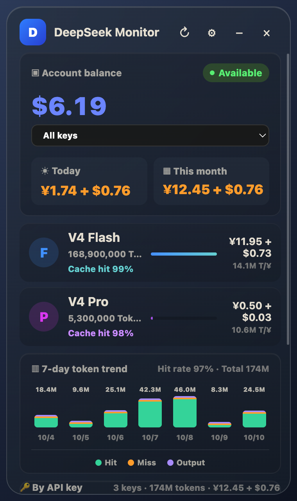
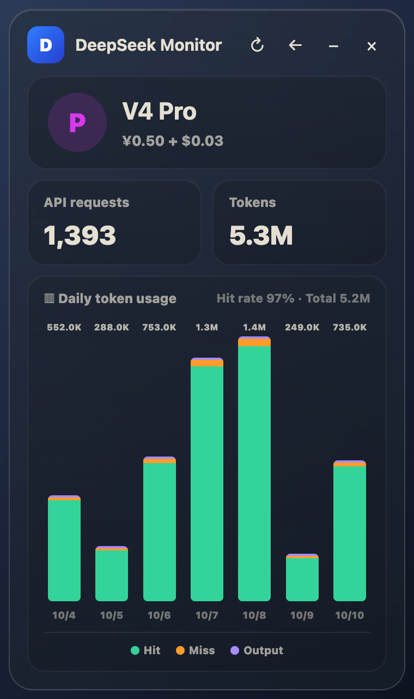
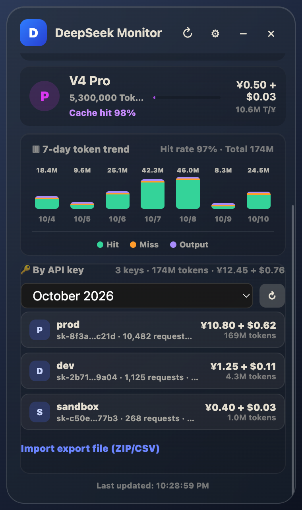
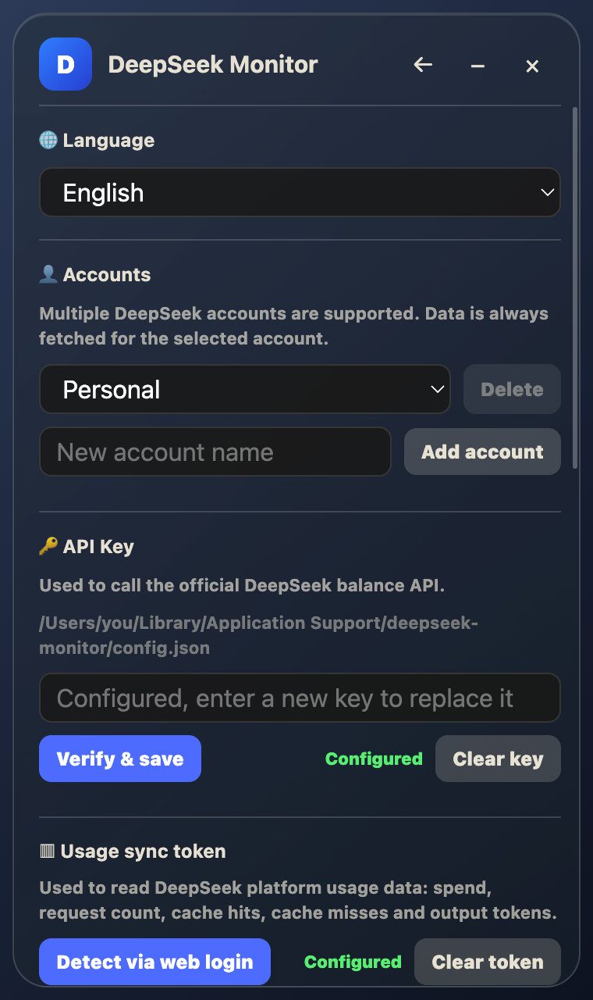

<div align="center">

# DeepSeek Monitor

A sleek, lightweight desktop app for tracking your DeepSeek account balance, API usage, per-key spending and cost trends in real time.

[](https://www.electronjs.org/)
[](LICENSE)
[](https://github.com/yaro-o-O/deepseek-monitor/releases)
[](https://github.com/yaro-o-O/deepseek-monitor/releases)
[](#)
[](https://github.com/yaro-o-O/deepseek-monitor/pulls)

**English** | [简体中文](README.zh-CN.md) | [Українська](README.uk.md)

</div>

---

## ✨ Why DeepSeek Monitor?

The official DeepSeek platform scatters balance and usage across pages, has no refresh button, and gives no per-key breakdown. **DeepSeek Monitor** puts everything on one compact dashboard:

- 💰 Balance at a glance, **auto-refreshed** while you work
- 📊 Per-model token consumption, cache hit rates and spend for **V4 Flash & V4 Pro**
- 🔑 **Per-API-key** requests, tokens, cache hit rate and spend — plus an all-keys total
- 💱 Costs shown **per currency** (`¥… + $…`) and never mixed together
- 📈 7-day trend charts with daily drill-down
- 🪟 Stays in your **system tray** — one click away, never in the way

## 📸 Screenshots

<p align="center">
  
</p>

<p align="center">
  
  
  
</p>

## 🚀 Features

- **Real-time balance monitoring** — query your DeepSeek account balance with one click; live available amount and account status
- **Dual-model usage stats** — token consumption, cache hit rate and spend for V4 Flash and V4 Pro separately
- **Per-API-key breakdown** — a "By API key" card splits the month's requests, tokens, cache hit rate and spend across every API key, from the official usage export (auto-fetched with the usage token, or imported as a ZIP/CSV). Pick any of the last 12 months
- **All-keys total** — the balance-card key picker also offers "All keys", which combines every key; it is the default view and drives Today, This month, the model rows, the chart and the detail view
- **Multi-currency costs** — if an account is billed in several currencies, costs are shown per currency (e.g. `¥12.45 + $0.76`) and never converted or summed together
- **7-day trend charts** — the last 7 days of token usage, broken down by cache hit / cache miss / output
- **Usage drill-down** — click a model row to see per-day token consumption and request counts
- **Balance alerts** — a system notification when your balance drops below a threshold you set (once per threshold crossing, per account)
- **Multi-account support** — manage several DeepSeek accounts and switch between them in Settings
- **English, Simplified Chinese & Ukrainian UI** — pick the interface language in Settings; the choice is saved
- **Encrypted credentials** — API keys and usage tokens are encrypted at rest using your OS keychain (Electron `safeStorage`)
- **In-app auto-updates** — new releases are detected and installed right from the app
- **Auto refresh** — 1 min / 5 min / 30 min / 1 hour intervals
- **Launch at startup** — supported on Windows and macOS
- **System tray** — closes or minimizes to the tray instead of quitting; summon it anytime
- **Always-on-top widget mode** — pin the window above other apps; hovering over it auto-hides or fades it to a preset opacity (click-through, so it never blocks your work) and it restores once the mouse moves away (controllable from the tray menu too)
- **One-click token sync** — built-in browser login window that captures your usage token automatically

## 🔑 Per-API-key usage

The live usage API only breaks usage down by model, so per-key figures come from the official **usage export** (`GET /api/v0/usage/export` — a ZIP with `amount-*.csv` + `cost-*.csv`).

- **Auto-fetch** — with a usage token set, the current month's export is downloaded and cached (with a short TTL). Use the ⟳ button in the "By API key" card to force a re-download, or pick another month in its selector.
- **Manual import** — export the file from the DeepSeek platform and drop it in via **Import export file (ZIP/CSV)**.
- **All keys** — the balance-card picker combines every key; it is the default view.
- **Money** comes from `cost.csv` and is allocated across keys / models / days by usage weight, so the per-key parts add up to the official total. Amounts are kept **per currency**.

API keys are only ever shown masked (`sk-abc…0def`); the full value never leaves the main process and is never logged.

## 📦 Installation

### Option 1: Download the installer (recommended)

Grab the latest installer from the [Releases page](https://github.com/yaro-o-O/deepseek-monitor/releases) — no Node.js required.

### Option 2: Build from source

**Prerequisites:** [Node.js](https://nodejs.org/) ≥ 18 and npm (or yarn).

```bash
# Clone the repo
git clone https://github.com/yaro-o-O/deepseek-monitor.git
cd deepseek-monitor

# Install dependencies
npm install

# Run in dev mode
npm start

# Or with dev tools
npm start -- --dev
```

### Packaging

```bash
# All platforms
npm run build

# Windows (NSIS installer)
npm run build:win

# macOS (DMG image)
npm run build:mac

# Linux (AppImage)
npm run build:linux
```

Build artifacts are output to `dist/`.

## 🧭 Getting Started

### First-time setup

1. Open the app and go to **Settings** (⚙ icon)
2. **API Key**: paste your DeepSeek API Key (starts with `sk-`), click "Verify & Save"
3. **Usage Token**:
   - **Option A (recommended)**: click "Sync via web login" — complete login in the popup window and the token is captured automatically
   - **Option B**: click "Paste token manually" — copy the Bearer token from your browser's dev tools

### Dashboard reference

| Area | Description |
|------|-------------|
| Account balance | Total balance and availability of the active account (always account-level) |
| API key picker | Scopes the figures below to one key — or **All keys** (default) for the whole account |
| Today | Spend so far today (account, or the selected key), per currency |
| This month | Month-to-date spend (account, or the selected key), per currency |
| V4 Flash / V4 Pro | Per-model monthly tokens, spend and cache hit rate (account, or the selected key) |
| By API key | Requests, tokens, cache hit rate and spend for each key of the selected month, plus the all-keys total |
| 7-day trend | Token consumption bar chart (hit / miss / output); click a model row for the daily detail view |

### Auto refresh

Enable "Auto refresh" in Settings and pick an interval — the app keeps balance and usage data up to date on schedule, and refreshes the per-key views alongside it.

## 🏗 Project Structure

```
deepseek-monitor/
├── .github/                 # CI workflow & issue/PR templates
│   └── workflows/build.yml  # Auto build & release on version tags
├── assets/                  # App icons and README screenshots
│   ├── icon.png
│   ├── icon.ico
│   └── screenshots/
├── src/                     # Source code
│   ├── main.js              # Main process: window management, IPC, API requests, config storage
│   ├── usage-export.js      # Pure parser for the official usage export (per-API-key aggregation)
│   ├── i18n.js              # UI strings (English / Simplified Chinese / Ukrainian)
│   ├── preload.js           # Preload script: safely exposes main-process APIs to the renderer
│   └── index.html           # Renderer: full UI and interaction logic
├── CONTRIBUTING.md          # Contribution guidelines
├── SECURITY.md              # Security policy
├── CHANGELOG.md             # Release history
├── package.json             # Project config & build scripts
├── README.md                # This file
├── README.zh-CN.md          # 简体中文
└── README.uk.md             # Українська
```

## 🛠 Tech Stack

- **Electron** — cross-platform desktop app framework
- **Native HTTP/HTTPS** — talks to the DeepSeek API directly, zero extra HTTP client dependencies
- **Vanilla frontend** — no UI framework, pure HTML/CSS/JavaScript
- **fflate** — unzips the official usage export in-process
- **electron-builder** — packaging & distribution

## 🔌 API Endpoints

The app uses the following official DeepSeek endpoints:

| Endpoint | Purpose | Auth |
|----------|---------|------|
| `GET /user/balance` | Account balance | API Key |
| `GET /models` | Available models | API Key |
| `GET /api/v0/usage/amount` | Usage statistics | Usage Token |
| `GET /api/v0/usage/cost` | Cost statistics | Usage Token |
| `GET /api/v0/usage/export` | Monthly usage export (ZIP with per-key breakdown) | Usage Token |

## 🔐 Configuration Storage

Config (API key, usage token, language, auto-launch, etc.) is stored in `config.json` under your system's user data directory:

- **Windows**: `%APPDATA%/deepseek-monitor/config.json`
- **macOS**: `~/Library/Application Support/deepseek-monitor/config.json`
- **Linux**: `~/.config/deepseek-monitor/config.json`

> **Security note**: the API key and usage token are encrypted at rest via the OS keychain (`safeStorage`) on Windows and macOS. On Linux without a keyring they fall back to plain text.

## 📝 Notes

1. **Usage token expiry** — tokens captured via web login may expire; re-sync if usage queries fail
2. **Balance vs. usage** — balance queries use the API key; usage statistics use a separate usage token
3. **Multiple currencies** — costs are shown per currency (e.g. `¥12.45 + $0.76`) and never converted or summed together
4. **All keys by default** — the balance-card picker starts on "All keys"; switch to a single key to scope the numbers
5. **Windows auto-launch** — via registry key `HKCU\Software\Microsoft\Windows\CurrentVersion\Run`
6. **macOS auto-launch** — via `~/Library/LaunchAgents/com.deepseek.monitor.plist`

## 🤝 Contributing

Contributions are welcome! Please read the [contributing guidelines](CONTRIBUTING.md) and [code of conduct](CODE_OF_CONDUCT.md) before getting started, and check the [security policy](SECURITY.md) before reporting vulnerabilities. Then feel free to open [issues](https://github.com/yaro-o-O/deepseek-monitor/issues) or submit [pull requests](https://github.com/yaro-o-O/deepseek-monitor/pulls).

**Looking for help?** Translate the UI, report bugs, or help answer questions in the issues — every bit counts for a young open-source project.

## 📄 License

[MIT](LICENSE) © [guniang2](https://github.com/guniang2)

---

> This is an independent third-party open-source tool and is not affiliated with DeepSeek.
